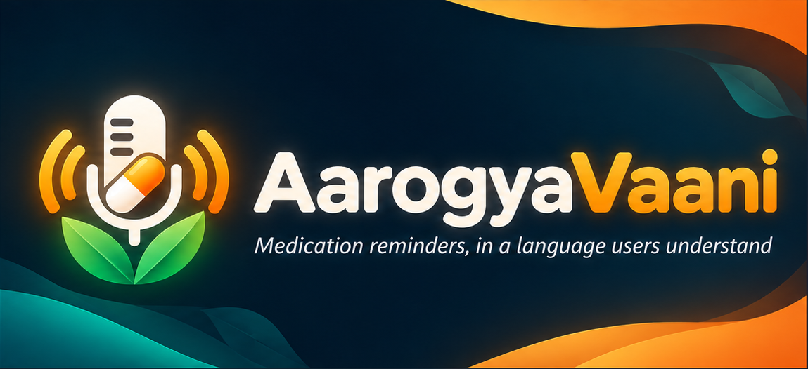
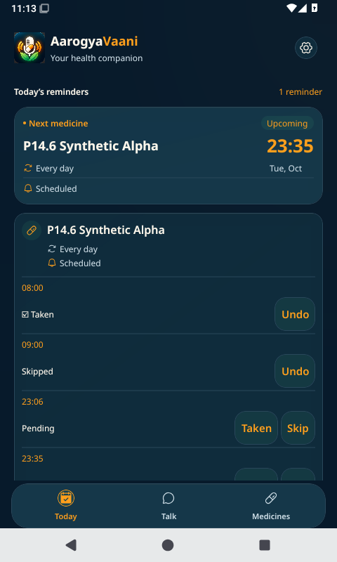
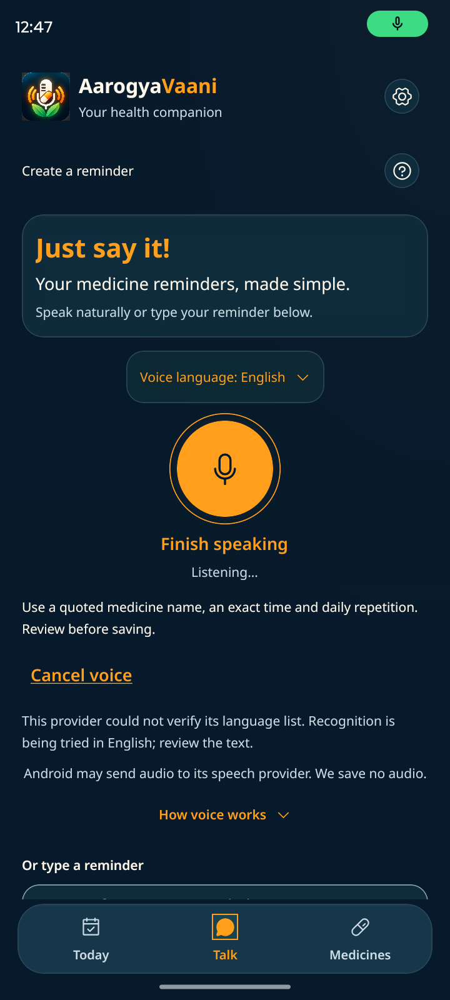
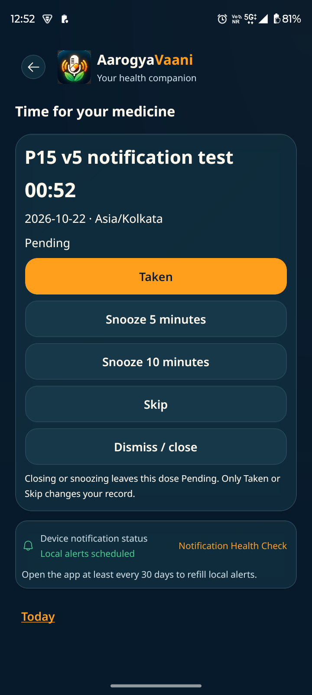
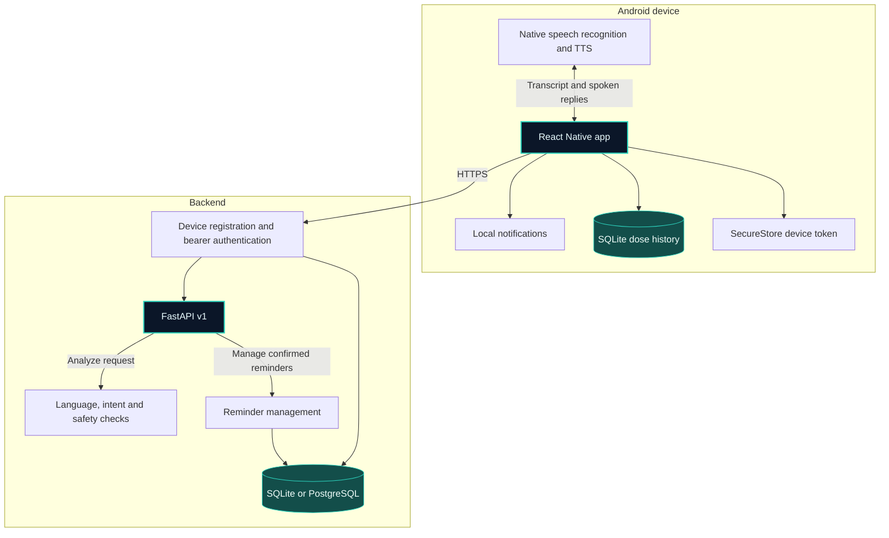

<p align="center">
  
</p>

<h1 align="center">AarogyaVaani</h1>

<p align="center"><strong>Smarter medicine reminders. In the language you understand.</strong><br>Voice-assisted scheduling and dose tracking for Android · Built by Kaushik Ram P</p>

<p align="center">
  
  
  
  
  
</p>

<p align="center">
  <a href="#application-showcase">Showcase</a> ·
  <a href="#system-architecture">Architecture</a> ·
  <a href="#testing-and-validation">Validation</a> ·
  <a href="#local-setup">Setup</a>
</p>

## Application showcase

<p align="center">
  <a href="docs/screenshots/today-dashboard.png"></a>
  <a href="docs/screenshots/talk-voice-entry.png"></a>
  <a href="docs/screenshots/dose-alert.png"></a>
</p>

<p align="center"><strong>Today · Talk · Dose alert</strong><br>Genuine Android captures from prototype testing.</p>

[View all four screenshots, including language selection](docs/screenshots/README.md)

## Overview

Setting a medicine reminder can be harder when the interface is complex or available only in English. AarogyaVaani lets users speak or type a reminder, check the interpreted schedule before saving, and respond to alerts from their Android phone. A manual form is available for direct entry.

## Key features

| Workflow | What the app does |
| --- | --- |
| **Speak, type or use a form** | The Talk screen interprets supported natural-language requests. Users review the medicine and schedule before saving. Supported replies can be read aloud. |
| **Plan the day** | Today highlights the next dose. Medicines lists reminders and supports editing and cancellation. |
| **Respond to a dose** | Local Android notifications open the dose screen. Record Taken or Skipped, undo a recorded action, or snooze the alert. |
| **Review history** | See individual dose records and daily and weekly progress, stored in SQLite on the device. |
| **Adjust the interface** | Choose from six UI languages, larger text, high contrast and reduced motion. |
| **Keep reminders device-scoped** | The FastAPI backend issues a device bearer token, stores its digest, and scopes reminder operations to that device. |
| **Limit the scope to reminders** | The language pipeline uses safety rules to refuse supported categories of medical advice requests. |

## Technology stack

| Android | Backend |
| --- | --- |
| React Native, Expo SDK 57, TypeScript and Expo Router | Python 3.12, FastAPI and Pydantic |
| Expo Notifications, SecureStore and SQLite | scikit-learn and rule-based language processing |
| Native speech recognition and text-to-speech | SQLite for local use, with PostgreSQL support for hosting |

## System architecture



[API overview](docs/api.md)

## Language support

| English | हिन्दी | தமிழ் | മലയാളം | ಕನ್ನಡ | తెలుగు |
| --- | --- | --- | --- | --- | --- |
| English | Hindi | Tamil | Malayalam | Kannada | Telugu |

All six have UI strings, script-appropriate fonts and backend language packs. Native-speaker review is incomplete, and supported reminder commands vary by language. Speech recognition and read-aloud behavior depend on the device and its installed providers.

## Testing and validation

| Component | Passed | Skipped |
| --- | ---: | ---: |
| Android · Jest | 871 | 1 |
| Backend · pytest | 916 | 1 |
| **Total** | **1,787** | **2** |

These suites ran from the staged source. Android TypeScript and design-token checks passed. Backend syntax and an in-process health check passed. The skipped cases are opt-in live integrations.

Historical records document Android development build work and successful preview APK installation and testing on an emulator and a physical device. Those runs are separate from the automated results above.


## Local setup

Use Node.js 24 with npm, Python 3.12, and an Android emulator or dedicated test device. For a native development build, install Android Studio, the Android SDK and a compatible JDK. Run these PowerShell commands from the repository root.

### Start FastAPI

```powershell
cd backend
py -3.12 -m venv .venv
.\.venv\Scripts\python.exe -m pip install -r requirements.txt
.\.venv\Scripts\python.exe -m uvicorn main:app --host 127.0.0.1 --port 8000 --no-access-log
```

Check the API with `Invoke-RestMethod http://127.0.0.1:8000/v1/health` from the host. The local backend creates its SQLite database under `backend/db/` when needed. Set `AAROGYAVAANI_DB` in the server process to use another writable path.

### Build and connect Android

The Android app requires a device-reachable HTTPS origin with no path, query or credentials. For local development, forward an HTTPS endpoint you control to the loopback FastAPI server. The certificate must be trusted by Android. Restrict access to the test environment.

In a second PowerShell session at the repository root:

```powershell
cd app
Copy-Item .env.example .env
# Edit .env and replace the example with your HTTPS API origin.
npm ci --include=dev
npx expo run:android
```

Keep credentials out of `EXPO_PUBLIC_API_URL`, which Expo bundles into the app. After installing the custom development client, run `npm start` for subsequent sessions. The app uses native modules that require a development build.

Allow notifications and check exact-alarm access and channel sound in Notification Health. Allow microphone access to use voice entry. Use a dedicated test installation when changing servers because saved device identity is scoped to its configured backend.

### Run tests

From `app/`:

```powershell
npm run typecheck
npm run lint
npm test
```

From `backend/` after creating the virtual environment:

```powershell
.\.venv\Scripts\python.exe -m pip install -r requirements-dev.txt
.\.venv\Scripts\python.exe -m pytest -q
```

## Known limitations

- Dose history and progress stay on the Android device. Reminder definitions persist on the configured backend.
- Voice availability and behavior depend on the installed speech and TTS providers. Translations and command coverage still need native-speaker review.
- Notification delivery depends on Android permissions, channel and exact-alarm settings, and power management. Physical-device verification covers a limited set of configurations.
- Clinical validation has not been performed. AarogyaVaani is designed for reminders and does not provide medical advice.

## Roadmap

- Review translations and representative reminder commands with native speakers.
- Expand notification, voice and accessibility testing across Android versions and device vendors.
- Document device replacement and evaluate opt-in export of dose history.

## Developer

**Kaushik Ram P** · [P-Kaushik-Ram](https://github.com/P-Kaushik-Ram)

## Copyright and usage

© 2026 Kaushik Ram P. All rights reserved for project-authored material. The source is available for portfolio review. No general permission is granted to copy, modify, or redistribute project-authored code. Third-party components retain their own licenses and permissions. [Third-party notices](THIRD_PARTY_NOTICES.md)
